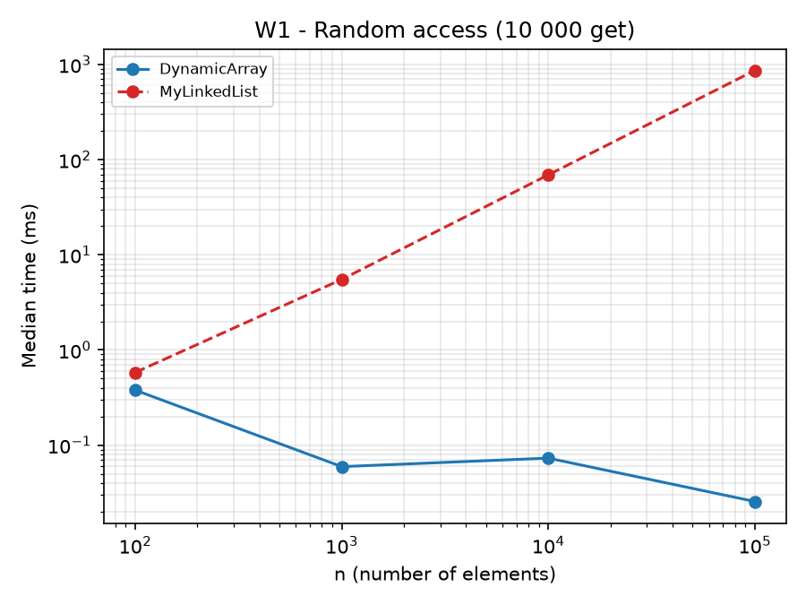
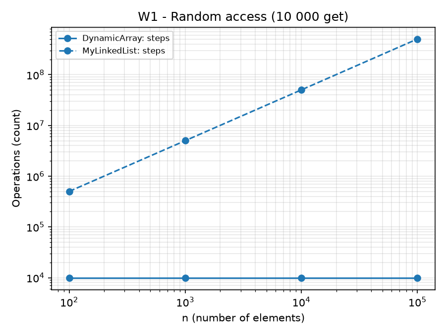
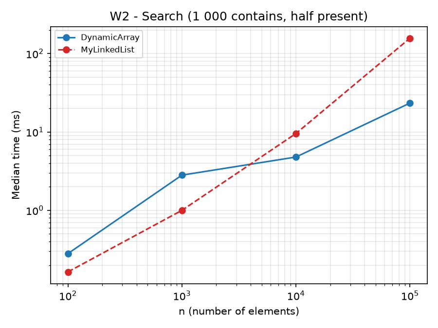
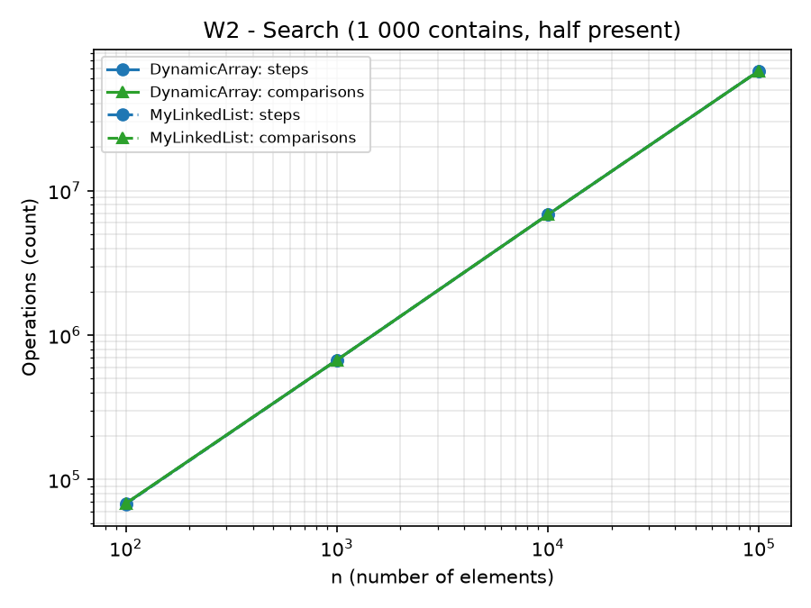
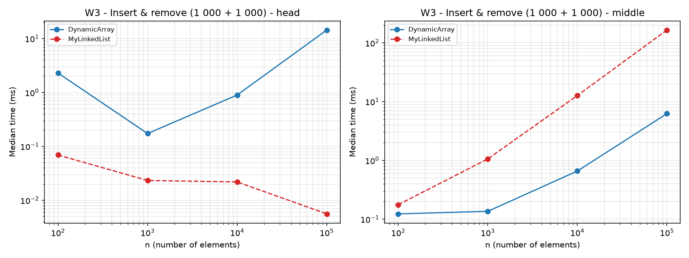
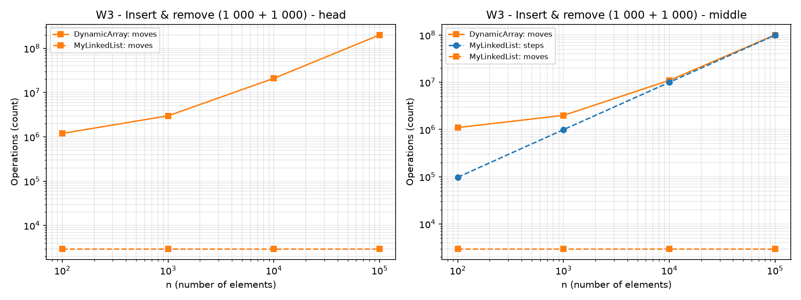
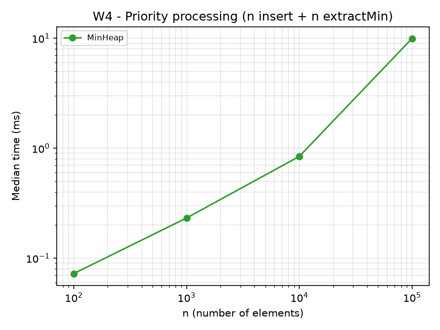
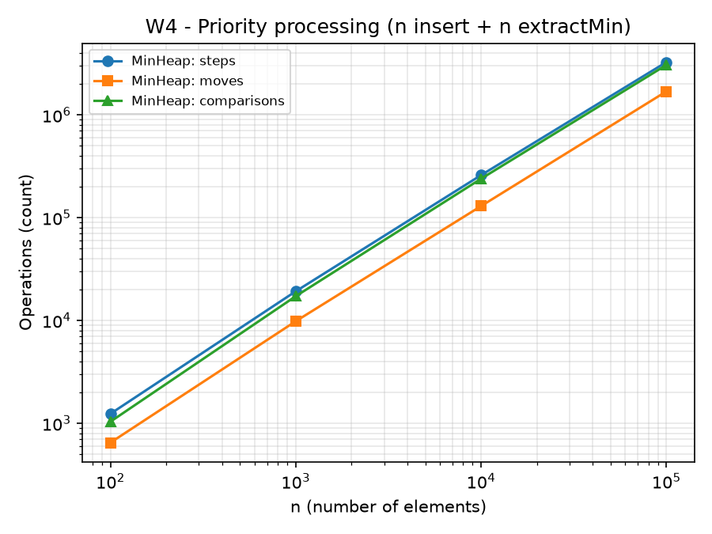

# Assignment 2 - In-Memory Workload Engine

## 1. Setup

- Structures (all store primitive `int`, no `java.util` collections): `DynamicArray` (`int[]`, 2x growth), `MyLinkedList` (singly linked, `head` + `tail`), `MinHeap` (array-based binary heap).
- Counters, incremented inside the methods:
    - **steps**: one read of an array cell, or one move to the next node (`get` in `DynamicArray` = 1 step, `get(i)` in `MyLinkedList` = `i` steps);
    - **moves**: one element shifted/copied in an array (including copies during growth), or one link update (`next`, `head`, `tail`) in the list;
    - **comparisons**: one comparison of two elements.
- Benchmark: `n` in {100, 1 000, 10 000, 100 000}, data from `new Random(42)`, 3 warm-up runs discarded, then 5 runs, the median time is saved. Only the workload itself is timed (filling the structure is not). Counters add the same small overhead to both structures.
- Reproduce: run `Benchmark.main` (it uses seed 42 and writes `results/results.csv`), then run the plotting script `plot.py` with `results/results.csv` and `results/plots` as arguments.

## 2. Complexity table

Notation: `n` = number of elements. Θ is used when best/worst bounds are tight.

### DynamicArray

| Operation | Best | Average | Worst | Justification |
|---|---|---|---|---|
| `add(x)` | Θ(1) | Θ(1) amortized | Θ(n) single call | Write at the end; a full array is copied once, doubling gives amortized Θ(1) (total copies < 2n). |
| `add(index, x)` | Θ(1) | Θ(n) | Θ(n) | `size - index` elements are shifted: 0 at the end, n at the head, n/2 on average. |
| `remove(index)` | Θ(1) | Θ(n) | Θ(n) | `size - index - 1` elements are shifted: 0 for the last, n-1 for the first. |
| `get(i)` | Θ(1) | Θ(1) | Θ(1) | One array read. |
| `contains(x)` | Θ(1) | Θ(n) | Θ(n) | Found at index 0 vs. a full scan (absent value, about n/2 for a present random one). |
| Auxiliary space | Θ(n) storage, capacity < 2n; O(1) extra per operation, O(n) temporary copy while growing. | | | |

### MyLinkedList (singly linked, with `tail`)

| Operation | Best | Average | Worst | Justification |
|---|---|---|---|---|
| `add(x)` | Θ(1) | Θ(1) | Θ(1) | Link after `tail`. |
| `add(index, x)` | Θ(1) | Θ(n) | Θ(n) | Index 0 or `size` needs no traversal; otherwise `index - 1` steps to the predecessor. |
| `remove(index)` | Θ(1) | Θ(n) | Θ(n) | Index 0 is O(1); removing the last node still needs a walk to the predecessor. |
| `get(i)` | Θ(1) | Θ(n) | Θ(n) | `i` steps from `head`. |
| `contains(x)` | Θ(1) | Θ(n) | Θ(n) | Same scan as the array. |
| Auxiliary space | Θ(n) nodes (each node = object header + `int` + reference); O(1) extra per operation. | | | |

### MinHeap

| Operation | Best | Average | Worst | Justification |
|---|---|---|---|---|
| `insert(x)` | Θ(1) | O(1) for random input | Θ(log n) | Bubble-up stops at once if `x >= parent`; worst case climbs the height `⌊log₂ n⌋`. Array growth is amortized Θ(1). |
| `peekMin()` | Θ(1) | Θ(1) | Θ(1) | Read `a[0]`. |
| `extractMin()` | Θ(1) (only with equal keys or n <= 2) | Θ(log n) | Θ(log n) | The moved last element is large, so it usually sinks to the bottom: about `log₂ n` levels. |
| Auxiliary space | Θ(n) storage; O(1) extra per operation. | | | |

## 3. Loop invariant proofs

### Proof 1: `DynamicArray.contains(x)`

```java
for (int i = 0; i < size; i++) {
    if (data[i] == x) return true;
}
return false;
```

**Invariant:** before each iteration with index `i`, `x` does not occur in `data[0..i-1]`.

**Initialization:** for `i = 0` the prefix is empty, so the statement is true.

**Maintenance:** assume it holds before iteration `i`. If `data[i] == x`, the method returns `true`, which is correct. Otherwise `data[i] != x`, so `x` is not in `data[0..i]`, which is the invariant for `i + 1`.

**Termination:** either the loop returns `true` because `data[i] == x`, or `i == size` and the invariant says `x` is not in `data[0..size-1]`, so `false` is correct.

**Conclusion:** in both cases the result equals "x is stored in the array", and the loop ends after at most `size` iterations, so `contains` is correct.

### Proof 2: bubble-down in `MinHeap.extractMin()`

Let `size` be the size after decrementing, `last` the old last element, `i` the current hole (`data[i]` is stale; `last` is written there at the end).

**Invariant:** before each iteration, with hole `i`:
- (a) `data[p] <= data[k]` for every parent-child pair `(p, k)` with `p != i` and `k != i`;
- (b) if `i > 0`, then `data[parent(i)] <= data[c]` for every child `c` of `i`;
- (c) if `i > 0`, then `data[parent(i)] <= last`.

**Initialization:** `i = 0`. The heap was valid before the extraction, so all pairs not involving cell 0 are valid: (a) holds. (b) and (c) are vacuous (the root has no parent).

**Maintenance:** suppose the loop continues, `m` is the smaller child of `i`, and `data[m] < last`. The body sets `data[i] = data[m]` and the new hole is `m`.
- Pair `(i, other child s)`: `data[m] <= data[s]` because `m` is the smaller child.
- Pair `(parent(i), i)`: `data[parent(i)] <= data[m]` by (b).
- Pairs `(m, children of m)` are excluded from (a) because `m` is the new hole; they held before, which gives (b) for `m`.
- (c) for `m`: `data[parent(m)]` is the old `data[m]`, which is `< last`.

**Termination:** `i` strictly increases and stays below `size`, so the loop ends: there are no children, or `last <= data[m]`. Then `data[i] = last` is written. Pair `(parent(i), i)` holds by (c); pairs `(i, children)` hold because `last <= data[m] <= other child`; all other pairs hold by (a).

**Conclusion:** after the loop every parent-child pair satisfies the heap property, and the returned value is the old root, the minimum. So `extractMin` is correct; it runs at most `⌊log₂ n⌋` iterations.

## 4. Results

Median time (ms) and counters (steps / moves / comparisons) at n = 100 000. Counters come from the last measured run and are deterministic.

| Workload | DynamicArray time | MyLinkedList time | DynamicArray steps/moves/comparisons | MyLinkedList steps/moves/comparisons |
|---|---|---|---|---|
| W1 random access | {{W1_AT}} ms | {{W1_LT}} ms | {{W1_AC}} | {{W1_LC}} |
| W2 search | {{W2_AT}} ms | {{W2_LT}} ms | {{W2_AC}} | {{W2_LC}} |
| W3 head | {{W3H_AT}} ms | {{W3H_LT}} ms | {{W3H_AC}} | {{W3H_LC}} |
| W3 middle | {{W3M_AT}} ms | {{W3M_LT}} ms | {{W3M_AC}} | {{W3M_LC}} |

MinHeap (W4, n = 100 000): time {{W4_TIME}} ms, steps {{W4_STEPS}}, moves {{W4_MOVES}}, comparisons {{W4_CMP}}.

### Plots

W1 - random access:  

W2 - search:  

W3 - insert & remove (head and middle):  

W4 - priority processing:  

Axes are logarithmic, so zero counter values (for example `moves` in W1) are not drawn.

## 5. Discussion

1. `DynamicArray.get(i)` costs exactly one step, while `MyLinkedList.get(i)` costs `i` steps; in W1 at n = 100 000 the list is {{W1_RATIO}}x slower ({{W1_AT}} ms vs {{W1_LT}} ms).
2. The array stores its `int` values contiguously, so one 64-byte cache line holds 16 values and a sequential scan uses every byte it loads (spatial locality).
3. The hardware prefetcher recognizes the sequential access and loads the next lines before they are needed, which is why even a simple iteration over the array is fast.
4. In W2 the array makes {{W2_CMP_A}} comparisons and {{W2_STEPS_A}} steps, the list {{W2_CMP_L}} comparisons and {{W2_STEPS_L}} steps, so the amount of work is practically the same, yet the list needs {{W2_RATIO}}x the time.
5. The reason is pointer chasing: each node's address is known only after the previous node has been loaded, so the CPU cannot overlap the loads and waits for memory on every hop.
6. Each list node is a separate object with a header (about 12-16 bytes), the `int` and a reference, so a node takes roughly 24 bytes against 4 bytes per array cell; the list touches several times more cache lines for the same data.
7. Nodes may also be placed far apart after garbage collection moves objects, and many small objects put extra pressure on the garbage collector, which the array avoids.
8. {{W3H_SENTENCE}}
9. {{W3M_SENTENCE}}
10. This shows that equal Big-O and even equal operation counts do not mean equal running time; constants and memory layout matter.
11. `MyLinkedList` is the better choice when insertions and removals happen mostly at the head or tail (queues, stacks) and random access by index is rare.
12. `MinHeap` is the better choice for priority scheduling: `peekMin` is O(1) and `insert` / `extractMin` are O(log n), while an unsorted array needs O(n) to find the minimum and a sorted array needs O(n) to insert.
13. In W4 the heap processed n = 100 000 jobs in {{W4_TIME}} ms with {{W4_CMP}} comparisons, which is {{W4_RATIO}} times `n log2 n` = {{W4_NLOGN}}.
14. `DynamicArray` remains the default for indexed access, scans and appends; the heap and the list win only in the specific access patterns above.